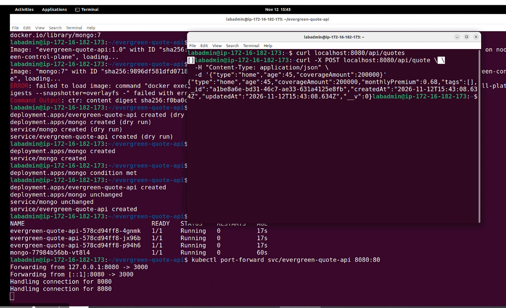

# Delivery Review: Evergreen Quote API

**Presenter:** Delivery Lead  
**Presentation:** Friday delivery review  
**Target:** 5 minutes, followed by 3 minutes of questions

## Slide 1 — Delivery goal and outcome

**Goal:** Deliver an assembled Evergreen Quote API with REST and GraphQL backed by MongoDB, tested, containerized, demonstrated on a local Kubernetes cluster, and merged to `main` through a reviewed pull request with green CI.

**Outcome: YES.**

**Why:** The API was assembled with REST and GraphQL backed by MongoDB, tested, containerized, and demonstrated on the local Kubernetes cluster. The team fixed the CI issue, the corrected run was green, and the reviewed pull request was merged to `main`.

## Slide 2 — What shipped

- **Repository:** [Evergreen Quote API](https://github.com/asc1-student05/evergreen-quote-api)
- **Project board:** [Evergreen Quote delivery board](https://github.com/users/asc1-student05/projects/4)
- **Pull request:** [PR #16 — merged successfully](https://github.com/asc1-student05/evergreen-quote-api/pull/16)
- **Corrected CI run:** [Successful Actions run](https://github.com/asc1-student05/evergreen-quote-api/actions/runs/43255734973/job/131313308404)
- **Demo evidence:** Screenshots saved separately show the service and delivery demonstrations.
 

**What the API does:** It serves quotes through REST and GraphQL, stores them in MongoDB, validates quote requests, and calculates premiums using the shared rate table.

## Slide 3 — Two important decisions

### Decision 1: Defer renters coverage

I recommended not adding renters coverage this week and putting it into a later planning round.

**Why it mattered:** Renters was not just a dropdown option. It required API/schema changes, an approved rate from the sponsor, seed data, tests, GraphQL changes, and a website update. Deferring it protected the agreed delivery goal and avoided taking on unplanned work without a pricing decision.

### Decision 2: GO after CI was fixed

During the Wednesday incident exercise, the supplied CI log showed a failing test run on `main`. The team fixed the CI issue, and the corrected run was green. I chose **GO** based on the corrected green CI signal.

**Why it mattered:** The decision used the recovery signal rather than treating the earlier red run as the final state. I also kept the customer-deployment question open for the release/engineering owner to confirm, because the failing run itself did not produce a build.

## Slide 4 — Risks and the two injects

### Main risk

**Risk:** Customers could be affected by a change that is not represented by the failing CI run.  
**Response:** Ask the release/engineering owner to confirm what version is deployed and how the customer-facing behavior reached users. Keep the investigation with the appropriate technical owner rather than trying to change the validator myself.

### Tuesday Inject #1 — Scope request and base-image CVE

- A partner requested renters quotes by Thursday and described them as “one more dropdown option.”
- At the same time, Platform reported a moderate CVE in the pinned `node:22-alpine` base image. The patched tag was expected next week, and the API was not internet-exposed this week.
- **My renters decision:** Defer it to a later round and record the work and dependencies on the project board.
- **What I needed:** A sponsor-approved renters rate for future planning and a clear platform/security decision on the current base image.

### Wednesday Inject #2 — Customer incident and simulated CI log

- Support reported quote requests failing with an age minimum of 110.
- The supplied log showed the test step failed because the change set the age minimum to 110, rejecting normal ages. Checkout, setup, MongoDB startup, and dependency installation passed; the tests caught the problem. That failing run produced no build.
- The simulated log was evidence for the exercise; it was separate from the learner’s own green branch.
- The team then fixed the CI issue, and the corrected run was green. I chose **GO** based on that corrected result.
- I did not assume the red run caused the customer-facing issue. I routed the question of what was actually deployed to the appropriate owner.

## Slide 5 — What I would do differently next time

- Confirm deployment ownership and how releases are gated by CI before an incident, so the team can quickly identify the version customers are using.
- Ask for sponsor decisions—especially pricing and scope—early, with a named owner and a clear response deadline.
- Keep separate records of CI results for the feature branch, `main`, and the corrected run so the release decision is based on the right evidence.

## Q&A preparation

**Why didn’t you add renters coverage?**  
Because it required changes across the API, pricing, data, tests, GraphQL, and website. The rate also needed a sponsor decision. Deferring it protected the agreed work for this delivery.

**Why did you choose GO after seeing a red CI run?**  
The red run was the earlier signal. The team fixed the issue, and the corrected CI run was green. I chose GO based on the corrected result—not the old red run. The PR also passed its review and merge checks.

**Did the red run cause customers’ quote errors?**  
I did not assume that. The red run produced no build, so I asked the release/engineering owner to confirm what version was serving customers and how the behavior reached them.

**What evidence supports the delivery outcome?**  
The merged PR, corrected green CI run, project board, and demonstration screenshots.

**What would you do if a required PR check were red?**  
I would pause the merge, share the failing evidence with the responsible owner, and proceed only after the required checks passed.

**What did you learn as delivery lead?**  
Tests and CI are delivery controls. My role during an incident is to share what the evidence says, route questions to the right owner, make a clear decision, and keep the team focused on the agreed goal.

---

**Thank you.**
